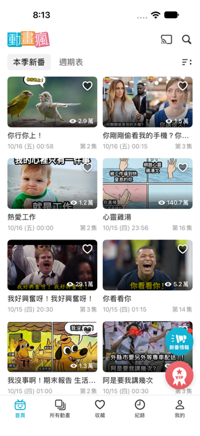
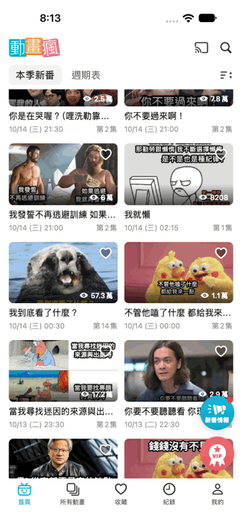

<div align="center">

# 📺 Bahamut Anime Crazy UI Clone (模仿巴哈姆特動畫瘋 App 畫面)

**A pixel-faithful iOS UI recreation of the Bahamut Anime Crazy (巴哈姆特動畫瘋) home screen built purely with SwiftUI, featuring 30 hilarious meme-themed anime episodes!**

[](https://developer.apple.com/ios/)
[](https://swift.org)
[](https://developer.apple.com/xcode/swiftui/)
[](https://developer.apple.com/xcode/)
[](#)

<br />

### 🌐 Language / 語言切換
[**🇺🇸 English Version**](#-english-version) ｜ [**🇹🇼 繁體中文版**](#-繁體中文版)

</div>

---

<a id="-english-version"></a>
<a id="english"></a>

# 🇺🇸 English Version

> 💡 *[點擊此處切換至繁體中文版](#-繁體中文版)*

## 📖 Overview

**Bahamut Anime Crazy UI Clone** is a native iOS application interface built with **SwiftUI** that meticulously recreates the iconic home screen of Taiwan's popular anime streaming platform — **Bahamut Anime Crazy (巴哈姆特動畫瘋)**.

Instead of standard anime covers, this special edition features **30 relatable internet memes** (covering coding life, debugging struggles, finals week, and office humor) presented as seasonal anime episodes in a responsive 2-column grid layout. Every visual detail—from the custom-drawn smiling TV mascot and cast icon to the floating gradient badges—is crafted directly in SwiftUI using `VStack`, `HStack`, `ZStack`, `ScrollView`, `GeometryReader`, and `Canvas`.

---

## 📸 Screenshots & Operation Demo

| 📱 App Screenshot | 🎬 Operation Demo (GIF) |
| :---: | :---: |
|  |  |
| *Home Screen — Seasonal Anime Grid* | *Smooth Vertical Scrolling & Heart Favorite Toggle* |

> 📌 **Tip:** Place your screenshot file as `screenshot.png` and screen recording GIF as `demo.gif` in the project root directory (or replace the `src` paths above with your image links).

---

## ✨ Key Features

- 🧭 **Fixed Top Navigation Header (`TopBarView`)**
  - Displays the custom **動畫瘋 (Bahamut Anime)** logo alongside custom vector **Chromecast / AirPlay** and **Search** action icons.
  - Features the **本季新番 (Seasonal Anime)** active pill tab, **週期表 (Schedule)** secondary tab, and a custom **Sort / Filter** icon.
- 🎞️ **Responsive 2-Column Meme Anime Grid (`ContentView` & `AnimeCardView`)**
  - Uses `GeometryReader` to dynamically calculate 16:9 widescreen card dimensions across all iPhone screen sizes.
  - Explicitly pairs 30 anime items into 15 two-column rows using `ScrollView` + `VStack` + `HStack`.
  - Each card includes a bottom dark gradient overlay (`ZStack`), view count with an eye icon, release date/time, episode number, and an optional gold **付費會員 (VIP Only)** badge.
- ❤️ **Interactive Favorite Button**
  - Tap the top-right heart icon on any anime card to toggle between liked (pink filled heart) and unliked states in real time.
- 🫧 **Floating Action Buttons (`FloatingButtonsView`)**
  - Anchored to the bottom-right corner above the tab bar using `ZStack(alignment: .bottomTrailing)`.
  - Includes the cyan gradient **新番情報 (New Anime Info)** megaphone button with a red notification dot and the coral-pink gradient **VIP** medal ribbon badge.
- 🎨 **Custom Vector Graphics with SwiftUI `Canvas` & `Shape`**
  - Custom-drawn icons including the cute smiling **Home TV Mascot (`HomeTVIconView`)**, **Triple-Stacked Squares (`AllAnimeIconView`)**, **Cast Icon (`CastIconView`)**, and **VIP Ribbon (`VIPRibbonIconView`)**—zero external icon libraries required!

---

## 🗂️ Project Structure

```text
模仿動畫瘋app畫面/
├── README.md                        # 📄 Project documentation (EN / ZH-TW)
├── screenshot.png                   # 📱 App screenshot
├── demo.gif                         # 🎬 App operation GIF
└── 模仿動畫瘋app畫面/
    ├── MyApp.swift                  # 🚀 App entry point (@main)
    ├── ContentView.swift            # 📱 Main layout combining Header, ScrollView Grid, TabBar & FABs
    ├── TopBarView.swift             # 🧭 Top navigation bar, Category pills, Cast & Sort custom icons
    ├── AnimeCardView.swift          # 🃏 16:9 Anime card with ZStack overlays & interactive heart button
    ├── AnimeItem.swift              # 📦 Data model & 30 meme-themed sample anime episodes
    ├── FloatingButtonsView.swift    # 🫧 Floating "新番情報" & "VIP" circular gradient buttons
    ├── BottomTabBarView.swift       # 🎛️ 5-tab bottom bar with custom Canvas TV mascot icon
    └── Assets.xcassets/             # 🖼️ Bahamut logo & 30 meme episode thumbnails (anime_01 ~ anime_30)
```

---

## 🛠️ Tech Stack & SwiftUI Components

| Category | Technologies / Components Used |
| :--- | :--- |
| **Language & UI** | Swift 5.9+, SwiftUI |
| **Layout Containers** | `VStack`, `HStack`, `ZStack`, `ScrollView`, `GeometryReader`, `Spacer`, `Divider` |
| **Custom Drawing** | `Canvas`, `Path`, `Shape`, `LinearGradient`, `RoundedRectangle`, `Circle`, `Capsule` |
| **State Management** | `@State` for interactive favorite heart toggling and tab selection |

---

## 🚀 Getting Started

1. **Clone the repository**
   ```bash
   git clone <your-repository-url>
   cd 模仿動畫瘋app畫面
   ```
2. **Open in Xcode**
   - Double-click `模仿動畫瘋app畫面.xcodeproj` to open the project in **Xcode 16.0** or later.
3. **Run the App**
   - Select an iPhone Simulator (e.g., **iPhone 16 Pro** or **iPhone 17 Pro Max**) and press **`Cmd + R`** to build and run.

---

<br />

<a id="-繁體中文版"></a>
<a id="繁體中文"></a>

# 🇹🇼 繁體中文版

> 💡 *[Click here to switch to the English Version](#-english-version)*

## 📖 專案簡介

**模仿巴哈姆特動畫瘋 App 畫面** 是一個使用純 **SwiftUI** 打造的 iOS 介面臨摹專案，完整還原台灣熱門動畫串流平台 **「巴哈姆特動畫瘋」** 的首頁視覺與排版細節。

本專案特別將動畫縮圖替換為 **30 部超有共鳴的精選迷因（Meme）番劇**（涵蓋工程師 Debug 日常、期末報告地獄、社畜心聲與搞笑梗圖），並透過 SwiftUI 的 `ScrollView`、`VStack`、`HStack`、`ZStack`、`GeometryReader` 與 `Canvas` 手繪向量圖示，細膩重現原版 App 的每個角落！

---

## 📸 畫面截圖與操作展示 (Screenshots & GIF)

| 📱 App 畫面截圖 (Screenshot) | 🎬 實際操作展示 (Operation GIF) |
| :---: | :---: |
|  |  |
| *動畫瘋首頁 — 本季新番雙欄瀑布流* | *上下滑動瀏覽 30 部迷因新番 & 點擊愛心收藏* |

> 📌 **小提示：** 請將截圖命名為 `screenshot.png`、操作錄影轉檔命名為 `demo.gif` 並放置於專案根目錄（或直接替換上方表格中的圖片連結）。

---

## ✨ 核心功能與介面亮點

- 🧭 **固定式頂部導覽列 (`TopBarView`)**
  - 左側配置「**動畫瘋**」經典 Logo，右側為手繪向量 **電視投影 (Cast)** 與 **搜尋** 圖示。
  - 下方包含「**本季新番**」（灰底圓角選中狀態）、「**週期表**」分類標籤，以及右側自訂繪製的 **排序篩選圖示**。
- 🎞️ **自適應雙欄 16:9 動畫卡片列表 (`ContentView` & `AnimeCardView`)**
  - 透過 `GeometryReader` 自動計算螢幕寬度與卡片 16:9 黃金比例，完美適配各種 iPhone 機型。
  - 結合 `ScrollView` + `VStack` + `HStack` 將 30 筆迷因番劇排成 15 列雙欄網格，支援流暢上下捲動。
  - 每張卡片皆以 `ZStack` 疊加底部黑色漸層遮罩、觀看次數（眼睛圖示 + 觀看數）、更新日期時間、集數，以及特定番劇專屬的金色「**付費會員**」標籤。
- ❤️ **互動式愛心收藏按鈕**
  - 每張動畫卡片右上角皆可點擊愛心按鈕，即時切換「已收藏（粉紅實心愛心）」與「未收藏」狀態。
- 🫧 **右下角雙懸浮按鈕 (`FloatingButtonsView`)**
  - 利用 `ZStack(alignment: .bottomTrailing)` 固定於底部導覽列右上方。
  - 完整還原青藍色漸層「**新番情報**」大聲公按鈕（含右上角紅點通知）與珊瑚粉漸層「**VIP**」星星勳章緞帶按鈕。
- 🎨 **純 SwiftUI `Canvas` 與 `Shape` 手繪向量圖示**
  - 底部導覽列的「**首頁微笑小電視 (`HomeTVIconView`)**」、「**所有動畫三層疊加方塊 (`AllAnimeIconView`)**」、頂部「**投影圖示 (`CastIconView`)**」皆使用原生 `Canvas` 與 `Path` 精準繪製，不依賴外部圖片套件。

---

## 🗂️ 專案檔案結構

| 檔案名稱 | 功能說明 |
| :--- | :--- |
| [`MyApp.swift`](模仿動畫瘋app畫面/MyApp.swift) | 🚀 應用程式進入點 (`@main`)，載入主畫面 `ContentView` |
| [`ContentView.swift`](模仿動畫瘋app畫面/ContentView.swift) | 📱 主畫面容器，整合頂部列、雙欄 `ScrollView` 列表、懸浮按鈕與底部 TabBar |
| [`TopBarView.swift`](模仿動畫瘋app畫面/TopBarView.swift) | 🧭 頂部導覽列，包含動畫瘋 Logo、投影/搜尋按鈕、「本季新番/週期表」切換列 |
| [`AnimeCardView.swift`](模仿動畫瘋app畫面/AnimeCardView.swift) | 🃏 單一動畫卡片元件，負責縮圖裁切、漸層遮罩、VIP 標籤、觀看數與愛心收藏互動 |
| [`AnimeItem.swift`](模仿動畫瘋app畫面/AnimeItem.swift) | 📦 動畫資料模型 (`Identifiable`) 與內建 30 部搞笑迷因新番假資料 |
| [`FloatingButtonsView.swift`](模仿動畫瘋app畫面/FloatingButtonsView.swift) | 🫧 右下角「新番情報」與「VIP」圓形漸層懸浮按鈕與自訂緞帶圖示 |
| [`BottomTabBarView.swift`](模仿動畫瘋app畫面/BottomTabBarView.swift) | 🎛️ 底部五個分頁導覽列（首頁、所有動畫、收藏、紀錄、我的）與手繪小電視圖示 |
| [`Assets.xcassets`](模仿動畫瘋app畫面/Assets.xcassets) | 🖼️ 存放 `bahamut_logo` 以及 `anime_01` ～ `anime_30` 共 30 張迷因封面圖 |

---

## 🛠️ 使用技術與元件

- **開發環境：** Xcode 16.0+ / Swift 5.9+ / iOS 17.0+
- **排版佈局：** `VStack`、`HStack`、`ZStack`、`ScrollView`、`GeometryReader`
- **視覺繪圖：** `Canvas`、`Shape`、`Path`、`LinearGradient`、`shadow`、`clipShape`
- **狀態管理：** `@State`（控制卡片愛心收藏狀態與底部導覽列分頁狀態）

---

## 🚀 如何執行專案

1. **下載或 Clone 專案**
   ```bash
   git clone <您的專案 Git 網址>
   cd 模仿動畫瘋app畫面
   ```
2. **使用 Xcode 開啟**
   - 點擊兩下開啟 `模仿動畫瘋app畫面.xcodeproj`。
3. **選擇模擬器並執行**
   - 選擇任一 iPhone 模擬器（推薦使用 **iPhone 16 Pro** 或 **iPhone 17 Pro Max**），按下快捷鍵 **`Cmd + R`** 即可編譯並執行。

---

<div align="center">

**[⬆️ Back to Top / 回到頂部](#-bahamut-anime-crazy-ui-clone-模仿巴哈姆特動畫瘋-app-畫面)** ｜ **[🇺🇸 English](#-english-version)** ｜ **[🇹🇼 繁體中文](#-繁體中文版)**

Made with ❤️ & SwiftUI

</div>
